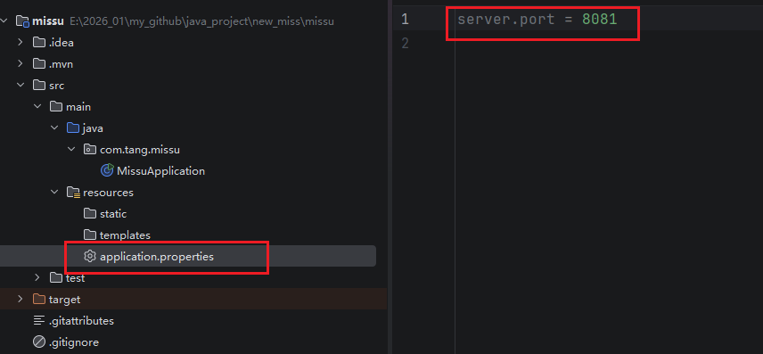
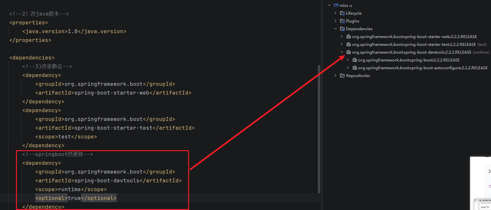
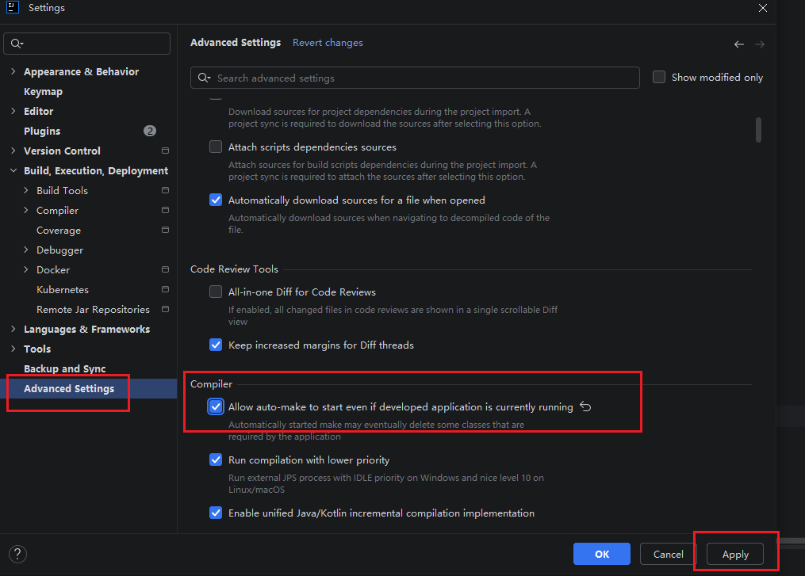

# java_practice

# JDK版本选择 - 选择 8
Alpha
Beta
GA
SNAPSHOT

# Maven -XML
## Gradle - Groovy 对比
## 安装maven到硬盘
- 检查版本 mvn -v（安装后需要新开窗口，Apache Maven 3.9.16）

# 开发工具选择
- JetBrain IntellJ Idea（更推荐）
- VsCode

# 新建第一个Spring Boot程序
## Spring Boot版本选择
- 2.2.1 GA （避免编码过程中出现的一些问题，版本先保持一致。）

## 何创建Spring Boot程序(3种)
- 1.Idea工具创建（推荐）
- 2.SpingBoot官网 初始化工具初始化（https://start.spring.io/）
- 3.Maven 

### SpingBoot官网创建
- generate之后是一个zip包解压到Idea中open打开

### Idea工具创建


# 在Idea中操作
- 用springBoot4创建项目然后改成 2.2.1版本+java8的壳子

## 修改
### 改项目的jdk版本
- File -> project Structure

set "PATH=E:\soft\java\apache-maven-3.9.16\bin;%PATH%"
### 开启maven自动导入
- setting -> Build,Execution -> Build Tools -> Maven -> Importing -> Import Maven projects automatically
### 改maven版本
- setting -> Build,Execution -> Build Tools -> Maven：home directory（用默认的maven 3 或者自己下载的版本 maven.apache.org/download.cgl） 
### 更新pom包
pom文件右键 -> Maven -> sync or re

## 运行项目
### 1 用命令行--运行的是jar包（打包的产物）
- 1) jdk8的命令行，set "PATH=E:\soft\java\apache-maven-3.9.16\bin;%PATH%",确保能输出mvn -v
- 2) mvn clean package - 输出的是springboot版本2.2.1，确认没问题
- 3) dir target\*.jar -看jar包大小
- 4) java -jar target\missu-0.0.1-SNAPSHOT.jar  - 运行jar包

### 2 Idea启用--运行的是编译后的代码不是jar
- 打开 src/main/java/com/tang/MissuApplication.java
  第 5 行 @SpringBootApplication 和第 8 行 main 方法左边，行号旁边有个绿色小三角，
  点它 → Run 'MissuApplication.main()'。

  如果那个三角是灰的或压根没有，说明 Maven 还没导完，回 Maven 面板 Sync Project。
- Run 一次之后，IDEA 顶部工具栏右侧的配置下拉里会多出 "MissuApplication"，
  旁边 ▶ 绿三角。以后直接 Shift+F10 重跑、Ctrl+F5 重调，不用再点代码。

- 看控制台
  跑起来底部 Run 窗口里应该出现：

    Tomcat started on port(s): 8080 (http)
    Started MissuApplication in x.xxx seconds
- 如果端口被占用改端口：


# 写api
- 在根目录在创建子包 api文件夹

## 注解- 给某个类或方法打上标记

## 接口路径写法推荐
- host:port/v1/banner/test1
- 版本号写法推荐：
1) 以上（更推荐）
2) 写在header中 version:v1
3) 写在url中 url?version = v1


# springBoot热更新配置
- 代码修改需要手动编辑重启服务器才成效，分为两步骤
1) 编译项目 - target中的文件变化
2) 重启服务器

### 1.安装devtools - 重启服务器
 - 1) 安装spring-boot-devtools，并确保依赖安转成功 
 SpringBoot Devtools
 ```xml
  <dependency>
      <groupId>org.springframework.boot</groupId>
      <artifactId>spring-boot-devtools</artifactId>
      <scope>runtime</scope>
      <optional>true</optional>
  </dependency>
```
- 2) 查看是否安装成功

 

 ### 2.修改Idea设置
 - setting -> Complier:勾选 Build Project automatically
 （每次保存Idea会自动编译）
 - setting -> Advanced Setting
 


 

# 软件工程
- 写出好的可维护的代码，需要遵守

## 开闭原则 OCP（最重要）- Open Closed Principle 
- 对（软件，函数，类等）扩展是开放的，对修改是封闭的
比如api的v1，v2；比如新增接口代替修改老的接口；

`如果要实现开闭原则，要实现 **面向抽象编程** `
### 面向抽象编程 
（忽略掉具体的类，使用抽象的东西 interface abstract）
- 三大特性：多态性
- 常用的手段：interface；工厂模式；IOC/DI

